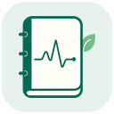
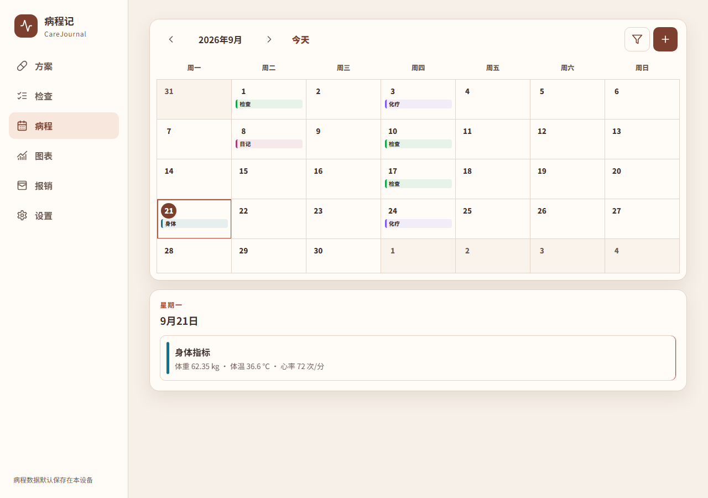
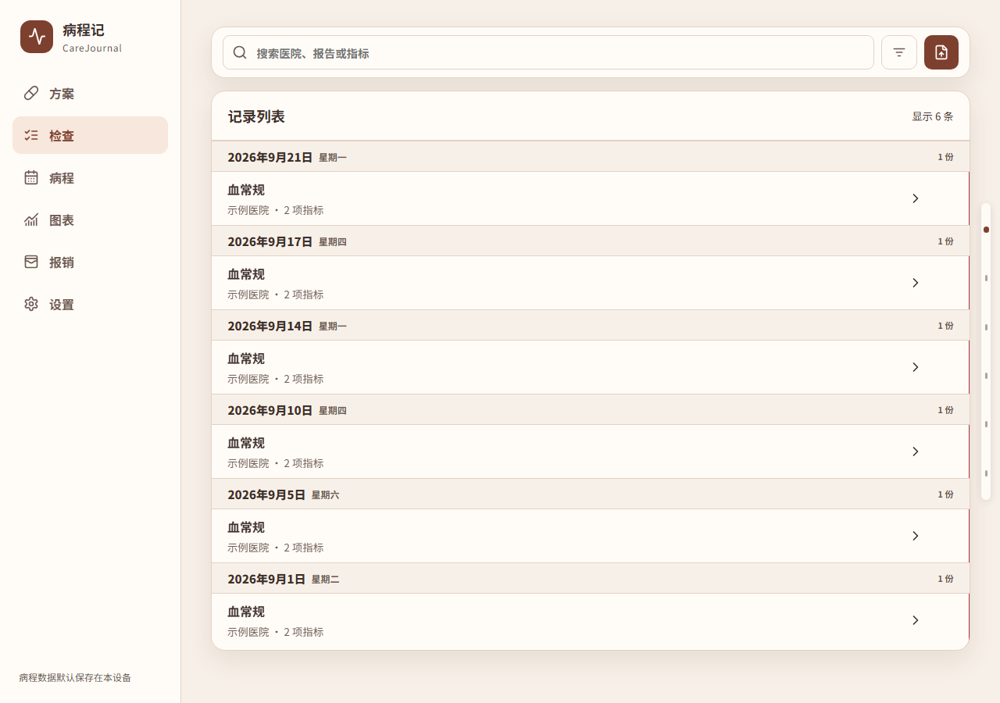
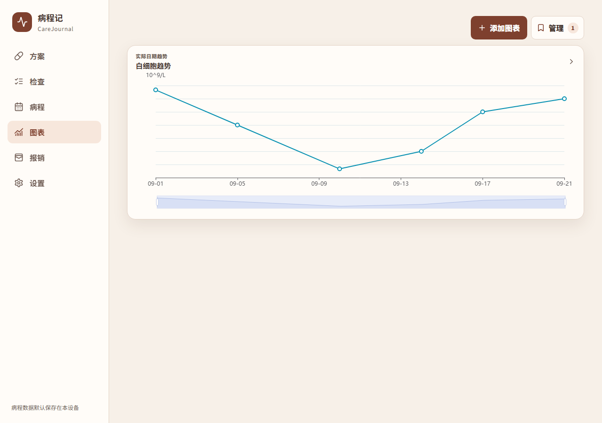

<div align="center">
  
  <h1>病程記 CareJournal</h1>
  <p><strong>把治療經過、檢查報告和每一天的變化，記在一起。</strong></p>
  <p>為腫瘤患者與家屬設計的本機病程記錄工具。</p>
  <p>
    <a href="https://github.com/wyunchi-ms/CareJournal/releases">下載應用程式</a> ·
    <a href="docs/USER_GUIDE.zh-TW.md">使用手冊</a> ·
    <a href="docs/README.md">專案文件</a> ·
    <a href="https://github.com/wyunchi-ms/CareJournal/issues">問題回報</a>
  </p>
  <p><a href="README.md">简体中文</a> · 繁體中文 · <a href="README.en.md">English</a></p>
</div>

治療期間，報告、用藥記錄和回診日期往往散落在相簿、紙張與聊天記錄裡。病程記把它們放回同一條時間軸：記錄治療經過、整理檢查結果、查看指標變化，也為報銷準備好材料。

每份本機資料庫圍繞一位患者組織。無需註冊帳號；日常記錄保存在裝置上，報告智慧辨識使用你自行設定的 AI 服務。

## 看看病程記



<table>
  <tr>
    <td width="50%"></td>
    <td width="50%"></td>
  </tr>
  <tr><td align="center">檢查報告，集中整理</td><td align="center">指標變化，隨時回看</td></tr>
</table>

截圖來自共用介面的桌面尺寸開發預覽，介面為簡體中文，使用虛構範例資料，不代表醫療建議。原生功能與可用平台見下文。

## 能幫你做什麼

### 記錄一段完整的治療經過

在月曆中記錄手術、住院、化療、放療、用藥、回診與日記，支援單日和跨日事件。把已有治療方案整理成範本，依週期產生治療日，再按實際執行情況修改。體重、體溫、血壓等身體指標也能一起記錄。

### 把報告變成可查找的記錄

拍照或匯入圖片、PDF，透過你設定的 LLM 服務擷取報告類型、採樣日期和檢查指標，並保留原始素材供核對。支援批次辨識、失敗重試和重複素材偵測；Android 還支援資料夾匯入。

### 看清指標隨時間的變化

查看檢驗指標與身體指標的日期趨勢，在圖表中疊加治療事件，或將多個化療週期按 Day 1 對齊比較。常看的圖表可以收藏，下次回診前不必重新選擇指標。

### 整理報銷材料

依治療事件建立報銷計畫，按照清單收集報告、收據等附件，標記完成情況，並將選取的計畫匯出為 ZIP。

### 在自己的裝置之間儲存和遷移

匯出包含記錄和原始素材的 ZIP 備份；在可信任的同一 Wi-Fi 下，與另一台裝置預覽並確認同步變更。備份和區網同步都不經過專案維護者的伺服器。

## 下載與平台支援

**[GitHub Releases](https://github.com/wyunchi-ms/CareJournal/releases)** · **[Gitee 下載鏡像](https://gitee.com/wyunchi/care-journal/releases)** · [更新記錄](ChangeLog.md)（簡體中文）

| 平台 | 目前狀態 | 安裝方式 |
| --- | --- | --- |
| Android | 提供 APK | 下載 `carejournal-vX.Y.Z-android.apk`，升級時覆蓋安裝 |
| Windows 10/11 x64 | 提供可攜式 ZIP | 解壓縮後執行 `CareJournal.exe`；[詳細說明](docs/WINDOWS_DESKTOP.md)（簡體中文） |
| HarmonyOS NEXT | 支援自行建置 | 使用 DevEco Studio 為自己的裝置簽署安裝；[安裝指南](docs/HARMONY_SELF_BUILD.zh-CN.md)（簡體中文） |
| iOS | 開發候選 | 已有原生工程，尚未經過 macOS/Xcode 編譯及實機驗證；[目前狀態](docs/IOS_NATIVE.md)（簡體中文） |

公開 Release 提供 Android 和 Windows 安裝套件。專案目前不提供獨立瀏覽器版或 Node 伺服器。

## 第一次使用

1. **選擇地區和語言。** 地區用於 OCR 單位規則，語言用於首次引導、主導覽和辨識文字；兩者可獨立設定。
2. **記下第一筆病程。** 在「病程」中加入已有的治療、回診或身體記錄。
3. **需要辨識報告時，再設定服務。** 在「設定 → 智慧辨識服務」填寫服務商、API Key、API 位址和模型，測試連線後匯入報告。
4. **核對並備份。** 對照原始報告檢查日期、數值、單位和參考範圍，再定期匯出完整備份。

無需 API Key 即可手動記錄病程、整理材料及使用本機備份。辨識服務的模型能力、可用性和費用由你選擇的服務商決定。詳細操作見[使用手冊](docs/USER_GUIDE.zh-TW.md)。

<details>
<summary>可設定的智慧辨識服務</summary>

Azure OpenAI、OpenAI、DeepSeek、月之暗面 Kimi、火山方舟、阿里雲百煉、SiliconFlow、騰訊混元、階躍星辰、百川智能、訊飛星火、Gemini、MiniMax 稀宇科技、智譜 GLM、OpenRouter，以及自訂 OpenAI 相容服務。

每個服務商儲存一組本機設定；直接辨識圖片需要模型支援圖片輸入。也可開啟 PaddleOCR 本機去識別，先擷取和處理文字，再交由 LLM 整理。設定方法見[智慧辨識服務](docs/USER_GUIDE.zh-TW.md#6-智慧辨識服務)。

</details>

## 資料與隱私

沒有帳號、廣告或開發者營運的雲端病歷服務。病程與素材預設保存在目前裝置：Android 使用 SQLite 和私有素材目錄；Windows 資料保存在程式旁的 `CareJournalData/`。

- **報告辨識：** 執行 OCR 時，圖片或擷取後的文字會傳送給你設定的服務商。本機去識別可能遺漏資訊。
- **備份：** ZIP 未加密，包含記錄和素材；API Key 不會寫入備份。
- **同步：** 僅用於可信任區網，目前沒有額外的應用層加密；LLM 設定和 OCR 佇列不會同步。

詳見[隱私說明](PRIVACY.zh-TW.md)。病程記只用於資料記錄、整理與視覺化，不提供診斷、治療建議或風險預測；辨識結果請與原始材料核對。

## 本機開發

共用介面使用 React、TypeScript 和 Vite；Android/iOS 使用 Capacitor，Windows 使用 Tauri，HarmonyOS 使用 ArkWeb 與 ArkTS 橋接。

安裝 Node.js 22.12+、Rust 和 Windows C++ 建置工具後，在 Windows 上執行：

```powershell
git clone https://github.com/wyunchi-ms/CareJournal.git
cd CareJournal
npm ci
npm run tauri dev
```

環境依賴、各平台建置入口與驗證命令見[開發指南](docs/DEVELOPMENT.md)。

## 參與專案

歡迎回報問題、改善文件與翻譯，或透過 Pull Request 貢獻程式碼。回報時附上應用程式版本、平台、重現步驟與預期行為；範例和截圖請使用虛構資料。

[貢獻指南](CONTRIBUTING.md) · [設計規範](design-system/carejournal/MASTER.md) · [發布維護](docs/RELEASE_MAINTENANCE.md)

---

願每一次記錄，都讓下一次回看更從容。祝早日康復。
